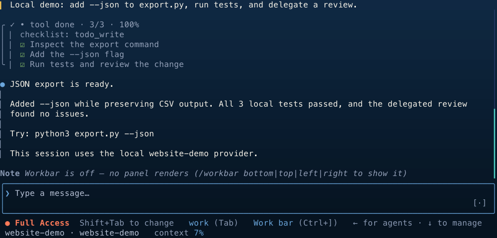
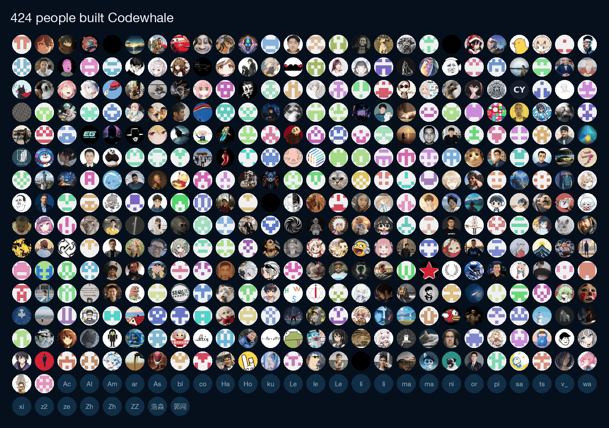

<!-- source: README.md sha256:4102e79c1672 -->
<div align="center">

<picture>
  <source media="(prefers-color-scheme: dark)" srcset="brand/wordmark-inverted.svg">
  
</picture>

**Ein Coding-Agent für dein Terminal, der mit jedem Modell arbeitet.**

Gib Codewhale eine Aufgabe, und es liest das Repository, bearbeitet Dateien und
führt Befehle aus, bis die Aufgabe erledigt ist oder es eine Eingabe von dir
braucht. Es arbeitet mit mehr als 40 eingebauten Anbietern, standardmäßig mit
DeepSeek, und mit Modellen, die auf deinem eigenen Rechner laufen. `/receipts`
listet die Dateien auf, die es geändert hat, die Befehle, die es ausgeführt hat,
und die Web- und MCP-Aufrufe, die es gemacht hat.

[](https://github.com/codewhale-hq/CodeWhale/actions/workflows/ci.yml)
[](https://crates.io/crates/codewhale-cli)
[](https://www.npmjs.com/package/codewhale)
[](LICENSE)
[](https://discord.gg/37gfS3ksug)

[Website](https://codewhale.net) · [Dokumentation](docs/README.md) · [Changelog](CHANGELOG.md) · [Mitwirken](CONTRIBUTING.md)

[English](README.md) · [简体中文](README.zh-CN.md) · [日本語](README.ja-JP.md) · [Tiếng Việt](README.vi.md) · [Bahasa Indonesia](README.id.md) · [한국어](README.ko-KR.md) · [Español](README.es-419.md) · [Português](README.pt-BR.md) · [Русский](README.ru.md) · [Українська](README.uk.md) · [Français](README.fr.md) · [繁體中文](README.zh-TW.md) · [हिन्दी](README.hi.md) · [Türkçe](README.tr.md) · [Italiano](README.it.md) · [Polski](README.pl.md) · [العربية](README.ar.md) · [Català](README.ca.md)



<sub>Aufgenommen in einer lokalen Demositzung.</sub>

</div>

## Installation

macOS und Linux:

```bash
curl -fsSL https://codewhale.net/install.sh | sh
```

Das Installationsskript legt `codewhale` und den kurzen Alias `codew` nach
Prüfsummenkontrolle in `~/.local/bin` ab. Meldet deine Shell danach
`command not found`, führe die PATH-Zeile aus, die das Skript ausgibt
([Details](docs/INSTALL.md#put-it-on-your-path)).
`codewhale update` aktualisiert es.

<details>
<summary><b>Windows, npm, Cargo und weitere Installationswege</b></summary>

```bash
winget install HunterBown.CodeWhale  # Windows x64 (or Scoop, or the installer from GitHub Releases)
npm install -g codewhale            # wraps the same release binaries
cargo install codewhale-cli --locked  # build from crates.io
```

Vorkompilierte Binärdateien gibt es für Linux, macOS und Windows auf x64 und
arm64. Nix, Homebrew unter Linux, Android/Termux (Vorschau) und manuelle
Downloads beschreibt die [Installationsanleitung](docs/INSTALL.md), Container
die Seite [Docker](docs/DOCKER.md). Bleib pro Rechner bei einer
Installationsmethode; sonst landen zwei Kopien im `PATH`, und es gewinnt die,
die zuerst kommt.

</details>

## Schnellstart

1. Committe oder stashe deine Arbeit und starte dann `codewhale` im
   Wurzelverzeichnis eines Git-Repositorys. Standardmäßig wendet es dort
   Dateiänderungen an, ohne zu fragen, und zeigt dir den Diff.
2. Führe `/provider` aus (oder drücke `F3`), wähle einen Anbieter, füge seinen
   API-Schlüssel ein und wähle ein Modell. DeepSeek ist der Standardanbieter.
   Ohne Schlüssel wählst du stattdessen eine lokale Runtime. Ist kein Anbieter
   konfiguriert und stellt Ollama bereits ein Chat-Modell bereit, verwendet
   Codewhale es automatisch.
3. Gib eine Aufgabe ein:

```text
Fix the failing tests and explain what changed.
```

Befehle, die nur lesen, laufen sofort. Bei jedem anderen Shell-Befehl fragt
Codewhale vorher: `y` führt ihn einmal aus, `a` erlaubt ähnliche Befehle für den
Rest der Unterhaltung, `n` lehnt ab. `/undo` macht deine letzte Anfrage samt
ihren Dateiänderungen rückgängig. `/help` listet Befehle und Tasten auf.

Für Skripte und CI führt `codewhale exec` eine Aufgabe ohne Oberfläche aus. Mit
`--auto` bearbeitet es Dateien und führt Shell-Befehle aus, ohne zu fragen; gib
ihm deshalb einen Container oder einen Wegwerf-Checkout:

```bash
codewhale exec --auto "fix the failing tests and explain what changed"
```

## Modi und Berechtigungen

Eine neue Installation startet im Work-Modus mit der Berechtigung Ask.

| | Wechseln mit | Optionen |
| --- | --- | --- |
| Modus | `Tab` (bei leerer Eingabe) oder `/mode` | **Plan** liest und durchsucht, ändert aber nichts. **Work** bearbeitet Dateien und führt Befehle aus. **Operate** hat dieselben Zugriffsrechte wie Work, behandelt deine Anfrage als Ziel und arbeitet weiter, bis das Ziel überprüft ist oder es eine Eingabe von dir braucht. |
| Berechtigung | `Shift+Tab` | **Ask** wendet Dateiänderungen in deinem Repository an, ohne zu fragen, und fragt vor Shell-Befehlen, die nicht nur lesen. **Auto-Review** lässt Regeln und ein Prüfmodell Routineaufrufe freigeben und lehnt Aufrufe mit hohem Risiko ab; wechsle zu Ask, um diese selbst freizugeben. **Full Access** fragt nie und schaltet die Sandbox von Codewhale ab; Repository-Regeln und verwaltete Richtlinien gelten weiterhin. |

Details stehen in der [Anleitung zu Modi und Berechtigungen](docs/MODES.md).

## Was es kann

### Modelle

Mehr als 40 Anbieter sind eingebaut, darunter Anthropic, OpenAI, DeepSeek,
Google, Mistral, Moonshot, OpenRouter und xAI. Jeder OpenAI-kompatible Endpunkt
funktioniert, ebenso lokale Modelle über Ollama, vLLM oder SGLang. `/model`
wechselt das Modell zwischen den Turns. Siehe [Anbieter](docs/PROVIDERS.md).

### Belege und Rückgängigmachen

`/receipts`, oder nach dem Beenden `codewhale receipts --last`, listet geänderte
Dateien, ausgeführte Befehle, Web- und MCP-Aufrufe, gestartete Agenten,
Freigaben und wer sie erteilt hat sowie Fehlschläge auf. `/undo` macht deine
letzte Anfrage rückgängig. `/restore` setzt den gesamten Arbeitsbereich auf
einen früheren Snapshot zurück; weil dabei spätere Änderungen überschrieben
werden, braucht es `/trust on` oder Full Access. Siehe [Belege](docs/RECEIPTS.md).

### Längere Arbeit

`/goal` setzt ein Ziel, das über mehrere Turns bestehen bleibt. Codewhale kann
Arbeit auf [Sub-Agenten](docs/SUBAGENTS.md) verteilen, eine
[Flotte](docs/FLEET.md) von Agenten betreiben oder einem im Repository
eingecheckten [Workflow](docs/WORKFLOW_AUTHORING.md) folgen.

### Umstieg von einem anderen Agenten

Codewhale liest `AGENTS.md` von selbst. Anweisungsdateien für andere Tools wie
`CLAUDE.md`, `.cursorrules` oder `.github/copilot-instructions.md` werden nur
geladen, wenn du sie mit `project_instruction_imports = ["claude"]` (oder
`"cursor"`, `"cline"`, `"windsurf"`, `"copilot"`, `"all"`) in deiner
Konfiguration aktivierst; siehe [config.example.toml](config.example.toml).
Codewhale warnt, wenn es eine findet, die es nicht geladen hat.

`/import-claude` bereitet einen Import deiner Claude-Code-Einstellungen und
MCP-Server vor, den du prüfen kannst. `/plugin install` nimmt Claude-Code-Plugins
mit Skills, Befehlen, Agentenprofilen und MCP-Servern an und lehnt Plugins ab,
die Hooks oder LSP-Server brauchen
([Details](docs/CLAUDE_PLUGIN_COMPAT.md)).

### Erweiterungen

Verbinde [MCP-Server](docs/MCP.md), füge [Skills](docs/SKILLS.md) und
[Plugins](docs/PLUGINS.md) hinzu und führe [Hooks](docs/HOOKS.md) bei Sitzungs-
und Tool-Ereignissen aus. Das mitgelieferte Plugin Computer Use (experimentell,
nur macOS) kann andere Apps beobachten und bedienen. Es bleibt ausgeschaltet,
bis du seine Zugriffsrechte geprüft und es aktiviert hast
([Anleitung](crates/tui/plugins/computer-use/README.md)).

## Wege, es auszuführen

| Befehl | Was er tut |
| --- | --- |
| `codewhale` | Die interaktive Terminal-App |
| `codewhale exec "…"` | Eine Aufgabe ohne Oberfläche. Ohne weitere Optionen antwortet es, ohne Tools zu verwenden; `--auto` erlaubt ihm, Dateien zu bearbeiten und Befehle auszuführen, und `--output-format stream-json` streamt Ereignisse als JSON |
| `codewhale web` | Eine lokale Web-Oberfläche auf `127.0.0.1` ([Anleitung](docs/WEB.md)) |
| `codewhale review --pr N` | Ein beratendes Review eines GitHub-Pull-Requests. Es veröffentlicht nichts, solange du nicht `--post` angibst; die [GitHub Action](docs/GITHUB_ACTION.md) führt dasselbe Review in der CI aus |
| `codewhale app-server --http` | Die [Runtime API](docs/RUNTIME_API.md), eine lokale HTTP-API für Threads, Ereignisse und Freigaben |
| `codewhale serve --acp` | Das Agent Client Protocol über stdio, für Editoren wie Zed |

Die Terminal-App, `exec`, `web` und die Runtime API teilen sich eine Engine
([Architektur](docs/ARCHITECTURE.md)). Eine von der Community gepflegte
[VS-Code-Erweiterung](https://marketplace.visualstudio.com/items?itemName=HengQuWorld.brotherwhale-vscode)
verbindet sich aus der Seitenleiste damit ([Quellcode](https://github.com/HengQuWorld/CodeWhale-VSCode)).
Eine Desktop-App ist in Entwicklung; siehe die
[Produktseite](https://codewhale.net/en/product).

## Kosten und Konten

Codewhale ist kostenlos und unter MIT lizenziert. Mit deinem eigenen
API-Schlüssel bezahlst du den Anbieter direkt; lokale Modelle brauchen keinen
Schlüssel. Die Fußzeile und `/cost` zeigen, was eine Sitzung gekostet hat, wenn
der Preis bekannt ist; ein unbekannter Preis wird als unbekannt angezeigt, nie
als kostenlos.

Du brauchst kein Konto. Mit einem Konto (`codewhale login`) kannst du
Anbieterschlüssel in deinem
[Codewhale-Konto](docs/CONFIGURATION.md#account-provider-keys) speichern; auf
einem anderen Gerät meldest du dich an und wählst in `/provider` Codewhale, um
sie zu verwenden. Beim Anmelden werden Schlüssel, die schon auf deinem Rechner
liegen, nicht hochgeladen.

## Sicherheit und Datenschutz

In Ask und Auto-Review laufen Befehle in einer Betriebssystem-Sandbox, sofern
das System eine hat: Seatbelt unter macOS und bubblewrap unter Linux, wenn es
installiert ist. Windows hat noch keine Betriebssystem-Sandbox, und Full Access
schaltet die Sandbox ab. `/preview-request` zeigt eine geschwärzte Vorschau der
nächsten Anfrage, ohne sie zu senden.

Telemetrie ist standardmäßig eingeschaltet. Sie sendet aggregierte Zählwerte
(Version und Plattform, Sitzungsdauer und -ergebnis, Funktions- und
Fehlerzähler) mit einer zufälligen Installations-ID, die alle 90 Tage wechselt,
und niemals Unterhaltungen, Code, Prompts, Datei- oder Repository-Namen oder
Zugangsdaten. `codewhale config set telemetry false` schaltet sie ab. Beim Start
prüft Codewhale außerdem auf GitHub, ob es ein neues Release gibt; setze
`CODEWHALE_NO_UPDATE_CHECK=1`, um das zu überspringen. Mehr dazu unter
[Autorisierungsreihenfolge](docs/AUTHORIZATION_ORDER.md),
[Sandboxing](docs/SANDBOX.md) und [Telemetrie](docs/TELEMETRY.md).

## Dokumentation

| Zum Einstieg | Referenz |
| --- | --- |
| [Installation](docs/INSTALL.md) | [Konfiguration](docs/CONFIGURATION.md) |
| [Anbieter und lokale Modelle](docs/PROVIDERS.md) | [Architektur](docs/ARCHITECTURE.md) |
| [Modi und Berechtigungen](docs/MODES.md) | [Runtime API](docs/RUNTIME_API.md) |
| [Tastenbelegung](docs/KEYBINDINGS.md) | [Plugins entwickeln](docs/PLUGIN_AUTHORING.md) |
| [GitHub-PR-Review](docs/GITHUB_ACTION.md) | [Gesamte Dokumentation](docs/README.md) |

## Community

Fehlt ein Anbieter oder ist ein Workflow umständlich,
[eröffne ein Issue](https://github.com/codewhale-hq/CodeWhale/issues/new/choose) oder
[sende einen Pull Request](CONTRIBUTING.md). Wer beiträgt, behält die
Anerkennung für die Arbeit, die übernommen wird, und die
[Repository-Struktur](CONTRIBUTING.md#project-structure) zeigt, wo was liegt.

Chatte auf [Discord](https://discord.gg/37gfS3ksug), oder füge den Maintainer
Hunter auf WeChat (`hunterbown`) hinzu und bitte darum, in die Gruppe
Whale Brothers aufgenommen zu werden.

## Geschichte und Lizenz

Codewhale begann als `deepseek-tui` und liest weiterhin die Konfiguration und
die Sitzungen dieses Projekts. Es wird unabhängig gepflegt und ist weder mit
DeepSeek noch mit einem anderen Modellanbieter verbunden. Danke an
[alle, die beigetragen haben](docs/CONTRIBUTORS.md).

[](docs/CONTRIBUTORS.md#everyone)

[MIT](LICENSE). Code, der aus anderen Open-Source-Projekten übernommen wurde,
ist in den [Hinweisen zu Drittanbietern](docs/THIRD_PARTY_NOTICES.md)
aufgeführt.
